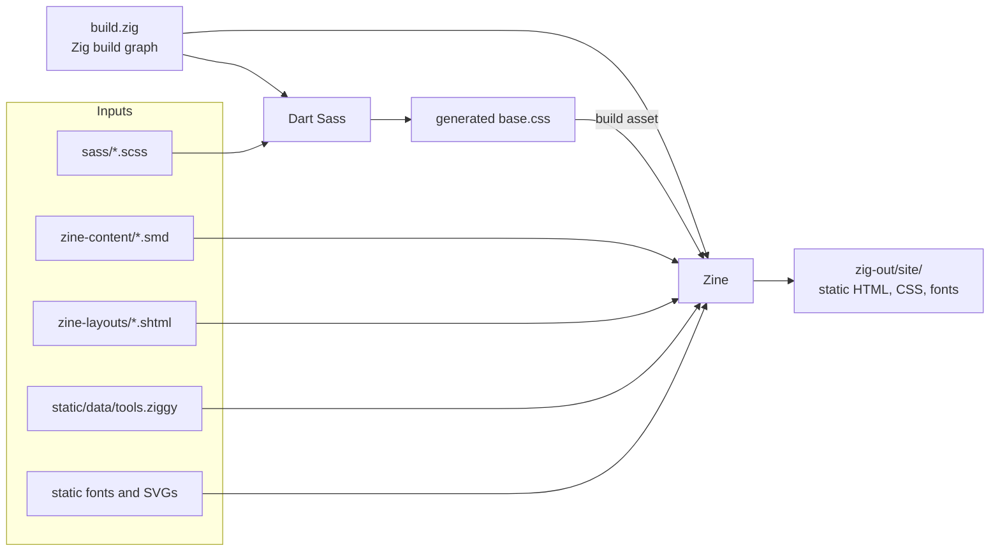
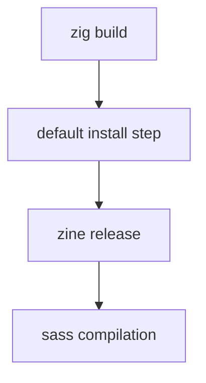
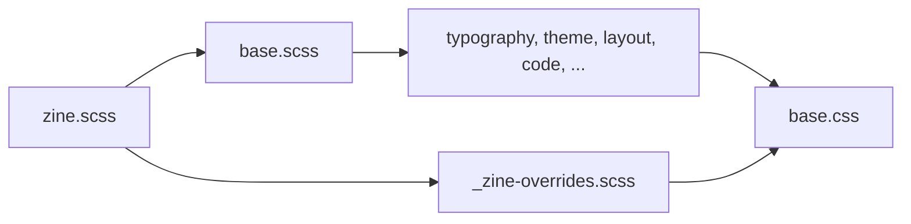
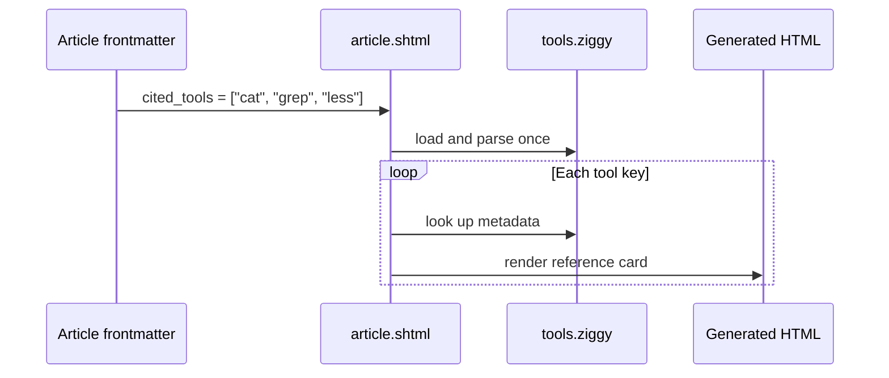

# How the Zine port works

This document explains the blog's Zine build without assuming prior knowledge
of Zig, Zine, SuperMD, or SuperHTML.

The original Zola site remains in `content/`, `templates/`, and `config.toml`.
The port lives alongside it so that both implementations can be compared until
Zine is ready to replace Zola.

## Quick start

The complete release build is:

```console
$ zig build
```

The generated site is placed in `zig-out/site/`.

For a development server with live content and template reloading:

```console
$ zig build serve
```

Then open <http://localhost:1990/blog/>.

Restart `zig build serve` after changing Sass. Zine watches its content and
layouts, but the Sass compiler is a separate build step and is not a persistent
watch process.

## The entire system at a glance



Zig does not render the blog. It describes the build graph: compile this Sass
file first, then run Zine with the resulting CSS file available as an asset.

Zine performs the actual site generation. It combines content written in
SuperMD with layouts written in SuperHTML and emits ordinary static files.

## Repository layout

```text
.
├── build.zig                  Zig build orchestration
├── zine.ziggy                Zine site configuration
├── zine-content/             SuperMD pages
│   ├── index.smd
│   ├── flashcards/
│   ├── flight-manual/
│   └── ramblings/
├── zine-layouts/             SuperHTML layouts
│   ├── templates/base.shtml
│   ├── article.shtml
│   ├── section.shtml
│   └── plain.shtml
├── static/                    Site assets and build data
│   └── data/tools.ziggy
├── sass/
│   ├── zine.scss             Zine stylesheet entry point
│   └── _zine-overrides.scss  SuperMD-specific compatibility styles
└── zig-out/site/             Generated output; ignored by Git
```

## The build, step by step

### 1. Zig reads `build.zig`

`zig build` looks for a public function with this shape:

```zig
pub fn build(b: *std.Build) void {
    // Describe build steps here.
}
```

A tiny amount of Zig vocabulary is enough to read this file:

| Zig | Meaning here |
|---|---|
| `const x = ...` | Define an immutable value named `x`. |
| `fn` | Define a function. |
| `pub fn` | Define a function visible outside this file. |
| `*std.Build` | A pointer to Zig's build-graph object. |
| `&.{ "a", "b" }` | A small array containing two strings. |
| `for (items) \|item\|` | Loop over `items`, naming each value `item`. |
| `void` | The function returns no value. |

The build file constructs a graph rather than immediately running commands.
Dependencies between steps decide their execution order.



The dependency from `zine release` to Sass guarantees that Zine cannot start
until `base.css` exists.

### 2. Sass is compiled

`compileStylesheet` creates the equivalent of this command:

```console
$ sass --no-source-map sass/zine.scss base.css
```

The real output path is inside Zig's cache rather than the repository root.
That output is represented by a `std.Build.LazyPath`: a path whose concrete
location becomes known when its producing step runs.

`sass/zine.scss` contains:

```scss
@forward 'base';
@forward 'zine-overrides';
```

It therefore includes the original design and a small compatibility layer for
HTML emitted by SuperMD. Zola continues to compile `sass/base.scss`, so the
Zine-specific rules do not alter the old site.

Sass discovers `@use` and `@forward` imports itself, while Zig does not. Rather
than duplicate Sass's dependency graph or maintain filesystem-discovery code,
the build simply runs Sass every time. Compilation takes only a few milliseconds
and adding a partial requires no build-file change.



### 3. CSS becomes a Zine build asset

The following arguments are added to the Zine process:

```text
--build-asset=base.css <zig-cache-path>/base.css --install=base.css
```

The layout accesses that generated file with:

```shtml
<link rel="stylesheet" href="$build.asset('base.css').link()">
```

Calling `.link()` does two things:

1. returns the correct public URL, including the `/blog/` prefix; and
2. tells Zine to copy the asset into the generated website.

This is different from files under `static/`, which are **site assets** and are
accessed with `$site.asset(...)`. The distinction is whether the file already
exists in the repository or is produced by a build step.

### 4. Zine reads `zine.ziggy`

Important settings include:

```ziggy
.zine_version = "0.14.0",
.site = .simple(.{
    .host_url = "https://ccjmne.sh",
    .url_path_prefix = "blog",
    .content_dir_path = "zine-content",
    .layouts_dir_path = "zine-layouts",
    .assets_dir_path = "static",
}),
```

Ziggy is Zine's data language. It resembles Zig syntax but is only data, much
like TOML or JSON. The installed `.ziggy-schema` files provide editor diagnostics
for both the site configuration and page frontmatter.

The host and path prefix are separate so production links become
`https://ccjmne.sh/blog/...` while the local server can still serve the same
paths correctly.

## Content: SuperMD

Every `.smd` file is a page. Its location determines its URL:

```text
zine-content/flight-manual/fcitx5/01-fcitx5-unicode.smd
                                      │
                                      ▼
/blog/flight-manual/fcitx5/01-fcitx5-unicode/
```

A page begins with Ziggy frontmatter:

```smd
---
.title = "Enter Unicode characters with fcitx5",
.date = .date("2025-11-04T00:00:00"),
.layout = "article.shtml",
.tags = ["quibblery"],
---
```

The remainder is SuperMD: GitHub-flavoured Markdown plus checked directives.

### Checked links

An internal link can use familiar Markdown:

```md
[Flight rules](/flight-manual/)
```

Zine resolves that to `/blog/flight-manual/` and rejects the build if the page
does not exist.

Explicit heading IDs are also checked:

```md
# [Unicode search]($heading.id('unicode-search'))
```

```md
[Jump there](#unicode-search)
```

This is why the Zine content does not use Zola's `@/...md` link syntax or
`{#heading-id}` extension.

### Notes and alerts

The old `note` shortcode becomes a native SuperMD block:

```md
> []($block.attrs('note'))
> This is a note with **Markdown** inside it.
```

An alert uses the same primitive with a different class:

```md
> # [Tip]($block.attrs('markdown-alert-tip'))
>
> Useful advice goes here.
```

No component concatenates an opening `<div>`, some arbitrary user text, and a
closing `</div>`. SuperMD creates a structured block and SuperHTML receives
validated HTML.

### Deliberate raw HTML

SuperMD rejects ordinary inline HTML. A deliberate HTML demonstration uses an
explicit escape hatch:

````md
```=html
<input type="password">
```
````

Zine parses and validates this HTML before including it. The `=html` marker
means “render this code”, while a normal `html` fence means “show this code”.

## Layouts: SuperHTML

`zine-layouts/templates/base.shtml` is ordinary HTML with checked extension
points:

```shtml
<head id="head">
  ...
  <super>
</head>
<main id="main">
  <super>
</main>
```

An article layout fills the matching element:

```shtml
<extend template="base.shtml">
<main id="main">
  ...
</main>
```

Both the tag name and ID must match. Replacing `<main id="main">` with a `<div>`
is a build error rather than an opportunity to emit malformed HTML.

### Scripty attributes

Template behaviour is expressed through HTML attributes:

```shtml
<h1 :text="$page.title"></h1>
<ctx :html="$page.content()"></ctx>
<article :loop="$page.leaves()">...</article>
<section :if="$page.footnotes?()">...</section>
```

| Attribute | Purpose |
|---|---|
| `:text` | Insert escaped text. |
| `:html` | Insert trusted generated HTML. |
| `:loop` | Repeat this element for every item. |
| `:if` | Keep this element only when a condition/value is present. |

`<ctx>` is a tagless context element. Its own tag is not emitted. It is useful
both for inserting content without an unwanted wrapper and for naming values.

The distinction matters to this blog because the existing Sass deliberately
styles direct children of `<article>`. This:

```shtml
<ctx :html="$page.content()"></ctx>
```

preserves those relationships, while a normal `<div :html="...">` would add a
wrapper and break several selectors.

## Data-driven referenced tools

Tool metadata is stored once in `static/data/tools.ziggy`. Articles only list
keys:

```ziggy
.custom = {
    "cited_tools": ["cat", "grep", "less"],
},
```

The article layout loads the data and resolves each key:

```shtml
<ctx tools="$site.asset('data/tools.ziggy').ziggy()">
  <div :loop="$page.custom.get('cited_tools')">
    <ctx tool="$ctx.tools.get($loop.it)">
      <strong :text="$ctx.tool.get('name')"></strong>
    </ctx>
  </div>
</ctx>
```

The data file is read during the build but is not copied into the public site,
because the layout calls `.ziggy()` rather than `.link()`.



## Adding another page

1. Create a `.smd` file under the appropriate section.
2. Add frontmatter with `title`, `date`, and `layout`.
3. Use `article.shtml` for articles and `plain.shtml` for standalone pages.
4. Give headings explicit IDs when they should appear as links in the TOC.
5. Add tool keys to `custom.cited_tools` when needed.
6. Run `zig build`.
7. Treat every reported broken link, unknown code language, malformed HTML node,
   or skipped heading level as a source error rather than suppressing it.

## What changes compared with Zola?

“Not built in” does not necessarily mean “lost”. Many Zola conveniences become
small, explicit pieces of site code.

| Zola capability | Zine port |
|---|---|
| Tera templates | Replaced by structurally checked SuperHTML. |
| Arbitrary shortcodes | Notes and alerts use SuperMD blocks. More specialised constructs need a directive, data-driven layout, or deliberate HTML block. |
| Built-in Sass | Replaced by an explicit Sass step in `build.zig`. |
| Automatic taxonomies | Replaced by explicit Ziggy manifests and SuperHTML tag-index/term layouts. The manifests currently cover migrated pages. |
| Automatic Atom feed | Replaced by the homepage's `atom` alternative and `atom.xml` layout. Its manifest currently covers migrated pages. |
| `reading_time` | Approximated from Zine's word count in `article.shtml`. |
| `<!-- more -->` summaries | Descriptions are used currently; explicit SuperMD content sections can replace excerpts later. |
| Markdown in title metadata | Titles are plain text. Rich display titles would need separate content or custom data. |
| GitHub alert syntax | Converted to native SuperMD blocks. |
| Inline HTML in Markdown | Intentionally rejected. Block HTML remains available through validated `=html` fences. Inline abbreviations currently lose their custom tooltip markup when ported. |
| Automatic heading anchors | SuperMD sections provide explicit checked IDs and linked headings; Sass restores the hash treatment. |
| Footnotes | Supported and rendered by the layouts. Migrated series explicitly prepend and renumber parent footnotes. |
| Syntax highlighting themes | Zine emits semantic Flow classes; `_zine-overrides.scss` maps them to the site's Catppuccin colours. |
| Drafts | Supported directly. |
| Internal link checking | Supported, including fragment IDs, and generally stricter than before. |
| External network link checking | No equivalent is currently wired into the build. A separate checker can be added. |
| Asset cache-busting | Not yet restored. Zine tracks assets, but the current public filename is simply `base.css`. |
| GitHub Pages deployment | Supported, but CI remains on Zola until the content migration is complete. |

### Visitor-facing capabilities currently absent

The preview does not yet have:

- every article;
- rich inline `<abbr>` tooltips in converted prose; or
- generic metadata generation for every not-yet-migrated tag and feed entry.

None of the essential static-site functionality is inherently impossible in
Zine. Taxonomies, feeds, and derived indexes are explicit site data rather than
implicit engine features.
Inline arbitrary HTML is the one intentional authoring restriction; components
that depended on it should be redesigned using SuperMD's structured primitives
rather than smuggled back as unchecked strings.

## Current migration status

The preview currently includes:

- the real homepage and an updated colophon;
- section indexes for flight rules, flashcards, and ramblings;
- the `fcitx5` section;
- multiple flight rules;
- one flashcard;
- one rambling;
- the 404 page and `/404.html` alias;
- shared tool-reference data;
- tag indexes and term pages for migrated content;
- a valid Atom feed and discovery link; and
- the existing visual system with a SuperMD compatibility layer.

Zola remains the production implementation until the remaining content,
metadata manifests, styling audit, and deployment workflow are complete.
